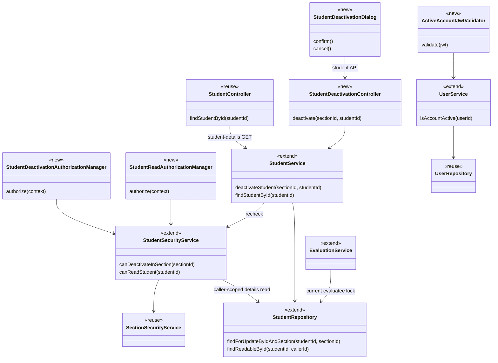
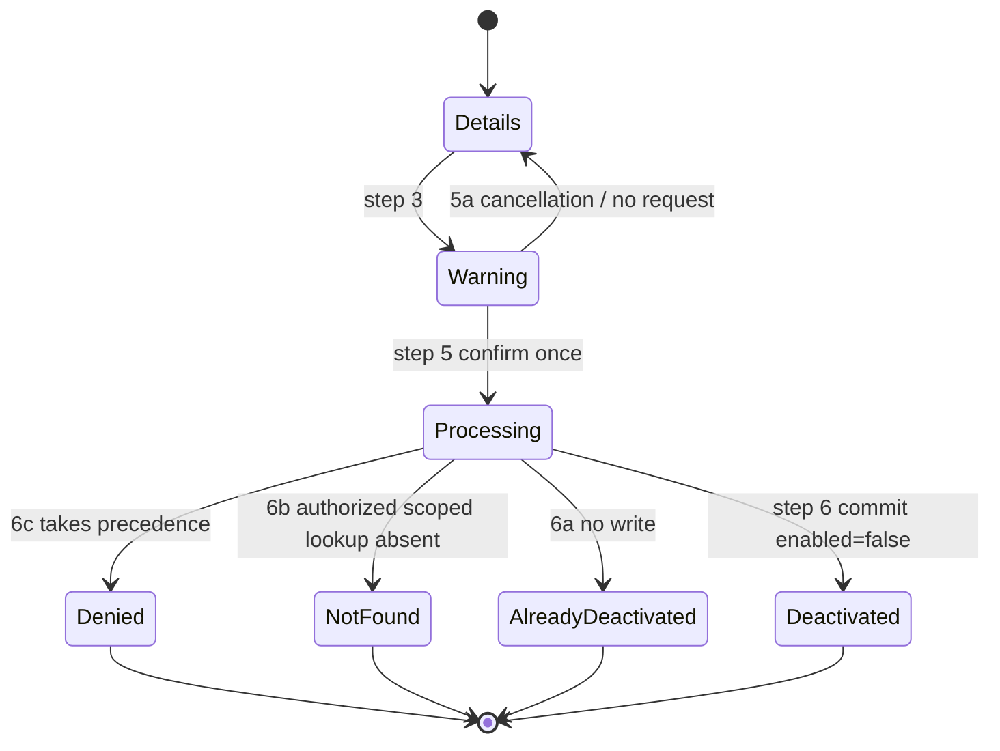

# Student Design

> Realizes: [UC-STU-deactivate-student](../requirements/use-cases.md#uc-stu-deactivate-student-the-course-admininstructor-deactivates-a-student).
> Depends on FRs: FR-SEC-authentication, FR-SEC-authorization, FR-SEC-deny-unauthorized, FR-SEC-active-account ([SRS](../requirements/software-requirements-specification.md#non-use-case-functional-requirements)).
> Status: base design merged on `main`; owning course admin read-access correction recorded during implementation, pending review before production work resumes. No report-permission expansion is authorized by this correction.
> See: [Containers](architectural-design.md#containers), [Architectural conventions](architectural-design.md#architectural-conventions), [Business Domain Model](../requirements/software-requirements-specification.md#business-domain-model), and [business rules](../requirements/business-rules.md).

## Overview

Extend the existing student slice with a course-section-scoped lifecycle command. The existing generic update is profile-only in this design; account status is changed through the explicit command. The security, evaluation, notification, and reporting integrations below realize the approved consequences without introducing another identity system or changing historical calculation inputs. Existing implementation pointers describe reused code; additions and changes are planned, not yet built.

The student-details prerequisite must admit the owning course admin even when she is not assigned to the student's course section. Correct only the student-details read path for that case; course ownership is resolved through the target student's actual course section, independently of the caller's default course section. Embedded performance reports are not prerequisites for confirmation or deactivation and do not inherit this additional read access.

## Components & classes

Paths in this table are relative to `backend/src/main/java/team/projectpulse/`; proposed files do not exist yet.

| Component | Reuse / change | Responsibility |
|---|---|---|
| `student/StudentDeactivationController.java` | New | Nested command route and outcome mapping to `Result`. |
| [StudentController](../../backend/src/main/java/team/projectpulse/student/StudentController.java) | Reuse | Existing student-details GET and StudentDto response; its route receives a dedicated read guard. |
| [StudentService](../../backend/src/main/java/team/projectpulse/student/StudentService.java) | Extend | `deactivateStudent(sectionId, studentId)` transaction, fresh authorization, profile-only updates; `findStudentById` uses a caller-scoped student-details finder. |
| [StudentRepository](../../backend/src/main/java/team/projectpulse/student/StudentRepository.java) | Extend | `findForUpdateByIdAndSection(studentId, sectionId)`: scoped query with pessimistic write lock; fresh locked evaluatee lookup for evaluation writes. `findReadableById(studentId, callerId)` scopes details to self, current instructor assignment, or ownership of the course reached through the student's course section. |
| [Student](../../backend/src/main/java/team/projectpulse/student/Student.java), [PeerEvaluationUser](../../backend/src/main/java/team/projectpulse/user/PeerEvaluationUser.java) | Reuse | Existing `enabled`, mandatory course section, optional team, shared account ID. |
| [StudentSecurityService](../../backend/src/main/java/team/projectpulse/student/StudentSecurityService.java) | Extend | `canDeactivateInSection(sectionId)` checks current course ownership or instructor assignment; `canReadStudent(studentId)` uses the caller-scoped details lookup; false for unresolved scope. Existing helpers used by mutation and report guards retain their current meaning. |
| [SectionSecurityService](../../backend/src/main/java/team/projectpulse/section/SectionSecurityService.java) | Reuse | Current `isSectionOwner` / `isSectionInstructor` database checks. |
| `security/authorizationmanagers/StudentDeactivationAuthorizationManager.java` | New | Read `sectionId` through `PathVariables`; delegate to the student security service; no student self-access or global admin override. |
| `security/authorizationmanagers/StudentReadAuthorizationManager.java` | New | Guard only `GET /students/{studentId}` through `canReadStudent`; do not reuse it for profile updates, deletion, or reports. |
| [SecurityConfiguration](../../backend/src/main/java/team/projectpulse/security/SecurityConfiguration.java) | Extend | Dedicated student-details GET rule, explicit deactivation POST rule, matching command access-denied handler, composed JWT validation. Existing PUT/DELETE and report rules retain their guards. |
| `security/ActiveAccountJwtValidator.java` | New | Current persisted account-status validation for bearer authentication. |
| [UserService](../../backend/src/main/java/team/projectpulse/user/UserService.java), [UserRepository](../../backend/src/main/java/team/projectpulse/user/UserRepository.java) | Extend / reuse | `isAccountActive(userId)` through the polymorphic account repository, without caching. |
| `student/StudentDeactivationAccessDeniedHandler.java`, deactivation-specific exceptions | New | Endpoint-specific denial message; distinguish service authorization failure and scoped not-found. |
| [ExceptionHandlerAdvice](../../backend/src/main/java/team/projectpulse/system/exception/ExceptionHandlerAdvice.java) | Extend | Exact 403/404 deactivation messages in the standard envelope, without changing unrelated exception messages. |
| [EvaluationService](../../backend/src/main/java/team/projectpulse/evaluation/EvaluationService.java) | Extend | Locked current-evaluatee eligibility checks on create/edit; historical aggregation unchanged. |
| [PeerEvaluationAverage](../../backend/src/main/java/team/projectpulse/evaluation/PeerEvaluationAverage.java), [PeerEvaluationDto](../../backend/src/main/java/team/projectpulse/evaluation/dto/PeerEvaluationDto.java), [converter](../../backend/src/main/java/team/projectpulse/evaluation/converter/PeerEvaluationToPeerEvaluationDtoConverter.java) | Extend | Current `enabled` on averages; `evaluatorEnabled` / `evaluateeEnabled` on details. Output metadata is never trusted as input. |
| [ActivityDto](../../backend/src/main/java/team/projectpulse/activity/dto/ActivityDto.java), [converter](../../backend/src/main/java/team/projectpulse/activity/converter/ActivityToActivityDtoConverter.java) | Extend | Current `studentEnabled` on returned activities. |
| [SubmissionStatusService](../../backend/src/main/java/team/projectpulse/notification/SubmissionStatusService.java) | Reuse | BR-submission-owed; no independent client calculation of obligations. |

Frontend paths are relative to `frontend/src/`.

| Component | Reuse / change | Responsibility |
|---|---|---|
| [StudentPerformanceDashboard.vue](../../frontend/src/pages/students/StudentPerformanceDashboard.vue) | Extend | Load student details first; account-status label and Deactivate action use the loaded student's `sectionId`. Defer mounting report panels until an explicit Show performance reports action; pass the actual `sectionId` to `StudentEvaluations`. See the report dependency review below. |
| `components/StudentDeactivationDialog.vue` | New | Consequence warning, all cancellation methods, single submission, outcome feedback. |
| [Student API](../../frontend/src/apis/student/index.ts) and [types](../../frontend/src/apis/student/types.ts) | Extend | Scoped deactivation command and discriminated outcomes. |
| [Students.vue](../../frontend/src/pages/students/Students.vue), [EditStudentForm.vue](../../frontend/src/pages/students/EditStudentForm.vue) | Extend | Consistent status labels; remove writable status switch from generic edit. |
| [SubmitTeamsEvaluations.vue](../../frontend/src/pages/evaluations/SubmitTeamsEvaluations.vue) | Extend | Eligible targets only for writes; existing inactive-target records read-only; choose create/update per evaluatee rather than the existing global flag. |
| [SectionsEvaluations.vue](../../frontend/src/pages/evaluations/admin/SectionsEvaluations.vue), [StudentEvaluations.vue](../../frontend/src/pages/evaluations/admin/StudentEvaluations.vue), [MyEvaluations.vue](../../frontend/src/pages/evaluations/MyEvaluations.vue) | Extend | Current status labels in historical results and evaluator details, under existing privacy rules. `StudentEvaluations` receives the target student's actual `sectionId` from the dashboard instead of reading the caller's default course section. |
| [TeamsActivities.vue](../../frontend/src/pages/activities/TeamsActivities.vue), [SectionsActivities.vue](../../frontend/src/pages/activities/admin/SectionsActivities.vue), [StudentActivities.vue](../../frontend/src/pages/activities/admin/StudentActivities.vue) | Extend | Current author status beside historical activities; preserve totals and records. |
| [Evaluation API types](../../frontend/src/apis/evaluation/types.ts), [activity API types](../../frontend/src/apis/activity/types.ts) | Extend | Additive response metadata. |
| [Shared request client](../../frontend/src/utils/request.ts), existing token/user/settings stores | Reuse | Bearer header, error-message toast, 401 logout, 403/404 navigation. No new store. |



## Sequence

### UC-STU-deactivate-student

```mermaid
sequenceDiagram
    actor Instructor as Course admin / instructor
    participant UI as Student details and warning
    participant API as Student API
    participant Security as Security filter chain
    participant Details as StudentController
    participant Controller as StudentDeactivationController
    participant Service as StudentService
    participant Access as StudentSecurityService
    participant DB as Database
    Instructor->>UI: Steps 1-2: view student details
    UI->>API: GET /students/{studentId}
    API->>Security: Student-details read guard
    Security->>Access: canReadStudent(studentId)
    Access->>DB: Scoped by caller and target student's actual course section
    Note over Access,DB: Self, assigned instructor, or owning course admin; no default course section
    Security->>Details: Dispatch student-details GET
    Details->>Service: findStudentById(studentId)
    Service->>DB: Repeat caller-scoped student-details lookup
    DB-->>Service: Authorized student
    Service-->>Details: Student
    Details-->>API: Result with StudentDto and actual sectionId
    API-->>UI: Student details
    Note over UI: Owning course admin needs no assignment; optional reports mount only when explicitly requested
    Instructor->>UI: Step 3: choose Deactivate
    UI-->>Instructor: Step 4: consequence warning
    Instructor->>UI: Step 5: confirm
    UI->>API: Submit once
    API->>Security: POST scoped command
    Security->>DB: FR-SEC-active-account: current caller status
    Security->>Access: Step 6: authorize course section
    Access->>DB: Current ownership / assignment
    Access-->>Security: Allowed
    Security->>Controller: Dispatch
    Controller->>Service: deactivateStudent(sectionId, studentId)
    Service->>Access: Recheck inside transaction
    Service->>DB: Scoped student lookup with write lock
    DB-->>Service: Active target
    Service->>DB: Set enabled=false; commit
    Note over Service,DB: Team and submitted records unchanged
    Service-->>Controller: DEACTIVATED
    Controller-->>API: 200 Result and student DTO
    API-->>UI: Outcome
    UI-->>Instructor: Step 6: success and current status
    Note over UI: Step 7: end
```

### Request-time alternatives

```mermaid
sequenceDiagram
    participant UI as Warning / student API
    participant Guard as Authentication and route guard
    participant Service as StudentService
    participant DB as Database
    UI->>Guard: Confirmed scoped command (step 6)
    alt Caller fails authentication
        Guard-->>UI: 401; existing logout handling
    else Current course-section authorization denied (6c)
        Guard-->>UI: 403; no target status disclosed
    else Route authorized
        Guard->>Service: Dispatch
        Service->>DB: Recheck current authorization
        alt Authorization now denied (6c)
            Service-->>UI: 403; no mutation or status disclosure
        else Authorized
            Service->>DB: Scoped target lookup with write lock
            alt Target absent in authorized scope (6b)
                Service-->>UI: 404; Student no longer exists
            else Already inactive (6a)
                Service-->>UI: 200 ALREADY_DEACTIVATED; no save
            else Active target
                Service->>DB: Change enabled and commit
                Service-->>UI: 200 DEACTIVATED
            end
        end
    end
```



## API contract

All paths below are relative to `/api/v1`. Responses use `Result` and existing `StatusCode` constants. IDs are read from route variables; the new command has no body. No scheduled jobs change.

For both command `200` outcomes, `Result.data` contains `outcome` and `student` (the current StudentDto); neither field is added to the top-level envelope. A no-op response returns the unchanged student's DTO. Command `403` and `404` responses have `data: null`, `flag: false`, and the matching existing status code. A `200` no-op means the command was handled, not that a new deactivation occurred: the UI branches on `data.outcome`, never just `flag`.

| Endpoint | Caller | Request | Success / change | Errors, by extension |
|---|---|---|---|---|
| `GET /students/{studentId}` | Existing student self / assigned instructor, plus current owner of the course reached through the target student's course section | Existing path ID; no default course section prerequisite | Existing StudentDto, including actual `sectionId`; dedicated read guard and caller-scoped finder | Existing generic `403` for route denial, including foreign course owner or unresolved target; generic `404` if the authorized target disappears before the scoped service lookup. The exact deactivation messages apply only to the command. |
| **New** `POST /sections/{sectionId}/students/{studentId}/deactivation` | Current owning course admin or assigned instructor, per BR-student-lifecycle / BR-section-scoped-access | Path IDs only | `200`, flag true, outcome `DEACTIVATED`, updated student DTO, message `Student has been deactivated.` | 5a: no request. 6a: `200`, flag true, outcome `ALREADY_DEACTIVATED`, message `Student is already deactivated`, no save or success toast. 6b: `404`, flag false, message `Student no longer exists`. 6c: `403`, flag false, message `You are not authorized to deactivate this student.`, no status data; precedence over 6a/6b. Authentication failure: `401`. |
| `PUT /students/{studentId}` | Existing profile-update authorization | Existing DTO | Same profile response; `enabled` may equal stored state but may not change | `400` if submitted `enabled` differs; no profile changes committed. Deactivation is available only through the command. |
| `POST /evaluations` | Existing evaluator authorization | Existing evaluation DTO | Existing response; current locked evaluatee must pass BR-evaluation-active-evaluatee | Existing evaluation-validation `400` envelope for inactive target; no evaluation written. |
| `PUT /evaluations/{evaluationId}` | Existing evaluator ownership | Existing evaluation DTO | Same check against the stored evaluation's evaluatee before ratings/comments change | Same `400`; existing records unchanged. |
| `GET /evaluations/sections/{sectionId}/week/{week}` | Existing course-section report authorization | Existing path fields | Add `enabled` to each average; preserve historical inputs and privacy | Existing errors unchanged. |
| `GET /evaluations/students/{studentId}/week/{week}` | Existing self / instructor authorization | Existing path fields | Add current `enabled`; preserve existing private-comment exclusion | Existing errors unchanged. |
| `GET /evaluations/students/{studentId}` | Existing report authorization | Existing week-range parameters | Add current `enabled` to each summary | Existing errors unchanged. |
| `GET /evaluations/students/{studentId}/week/{week}/details` | Existing instructor authorization | Existing path fields | Add `evaluatorEnabled` and `evaluateeEnabled`; preserve scores/comments and privacy | Existing errors unchanged. |
| `GET /evaluations/evaluators/{evaluatorId}/week/{week}` | Existing evaluator access | Existing path fields | Same current-status metadata; inactive-target rows remain readable but are excluded from write preparation | Existing errors unchanged. |
| `POST /activities/search` | Existing scoped activity access | Existing criteria and pagination | Add `studentEnabled` to each returned activity | Existing errors unchanged. |
| `GET /activities/{activityId}` | Existing scoped activity access | Existing activity ID | Same additive metadata | Existing errors unchanged. |

The course-section route guard runs without loading the target student. Once authorized for that course section, an absent student or a student outside that course section is uniformly absent from the scoped query (`404`), consistent with the architecture's two enforcement points. Never use a global target lookup to distinguish the two.

### Owning course admin details and report dependency review

The additional student-details permission applies only to `GET /students/{studentId}`. Its route and service queries derive authorization from persisted relationships through that student's actual course section and the caller from `UserUtils`; an admin authority alone is insufficient. Do not change `UserOwnershipAuthorizationManager` or the existing assigned-instructor helper to add course ownership: those are shared by profile mutations and reports. Do not assign the course admin to the course section as a workaround, change her default course section, or use a caller-supplied course section as the read boundary.

The current dashboard eagerly mounts `StudentActivities` and `StudentEvaluations`. Change that presentation dependency: load the student-details shell first and mount those panels only when the user explicitly chooses **Show performance reports**, independently of the Deactivate action. This applies consistently to dashboard users and adds no report capability field or permission-discovery endpoint. An owning course admin without assignment can load details, open/cancel/confirm the warning, and show the result without requesting reports. Existing reports remain available on explicit request under their current authorization and privacy rules; the extra click is the UI tradeoff for avoiding a permission expansion. Pass the loaded student's actual `sectionId` to `StudentEvaluations` when it is mounted; do not substitute defaults. A report action is not permission to read a report, and its refusal still uses existing error handling.

The following inventory identifies every endpoint those panels call; it is a review of dependencies, not authorization to widen their access. No additional report access is necessary for the lifecycle workflow under the deferred-panel design. Any later proposal to expand report access must be justified and reviewed separately before implementation; do not issue forbidden report requests as automatic capability probes.

| Endpoint (relative to `/api/v1`) | Current dashboard dependency and access gap | Scope of this correction |
|---|---|---|
| `POST /activities/search` | `StudentActivities` automatically searches by student and week range. The service restricts instructors/admins to their default course section, which may differ from the target student's course section or be unset. A working owner report would require a newly reviewed caller-authorized scope through the target student's actual course section; adding a body filter alone is insufficient. | No permission or query-scope expansion. Not required for lifecycle details/confirmation. |
| `GET /evaluations/students/{studentId}` | `StudentEvaluations` loads the student's evaluation summaries. Its shared route guard admits self or an assigned instructor; ownership without assignment does not suffice. Owner report access would need a separate read-only guard and scoped finder, without changing shared mutation guards. | No permission expansion. Not required for lifecycle details/confirmation. |
| `GET /sections/{sectionId}` | `StudentEvaluations` loads the course section's rubric ID. The current code uses the caller's default course section; the route admits enrolled students or assigned instructors. An owner report would instead need the target student's actual course section and an explicitly reviewed owning-course-admin read rule. | No permission expansion. Do not use the default course section as a substitute or call this endpoint just to enable deactivation. |
| `GET /rubrics/{rubricId}` | `StudentEvaluations` loads criteria from the course section's rubric. Current authorization is course-instructor membership or the student's course-section rubric. Lack of course-section assignment alone does not remove course-instructor access; verify the persisted relationship rather than adding a global admin override. | No permission expansion. Any report use must resolve the rubric from the target student's actual course section, not the caller's default. |

The dashboard does not call `GET /evaluations/students/{studentId}/week/{week}/details`: that drill-down is in `SectionsEvaluations`. It likewise needs no additional section-wide evaluation report, evaluator-history, or individual activity-read permission to deactivate a student. Those routes retain existing authorization. This correction does not claim to make the owning course admin's embedded reports available without assignment; that is a separate access review if requested.

## Key decisions

- **Explicit scoped lifecycle command.** Rejected the generic profile PUT and `UserOwnershipAuthorizationManager`: the latter admits self-access, and target-derived guards cannot authorize after deletion. Authorize the course-section context first, then scope the target query. Recheck authorization in the mutation transaction, using `UserUtils` for caller identity and current database relationships rather than token roles or default selections alone.
- **Owning course admin can reach confirmation without assignment.** Add course-owner access only to the student-details GET through a dedicated read guard and caller-scoped finder; resolve the actual course section from the student. Defer embedded report panels behind an explicit Show performance reports action for all dashboard users, keeping lifecycle details independent of report access without new permission metadata. Rejected widening the shared user-ownership manager, automatic course-section assignment, changing defaults, or silently extending report permissions: each would grant unrelated access or change user state merely to reach a lifecycle action. The report dependency review above is the boundary of this correction.
- **Profile edits cannot change account status.** Reject a changed `enabled` value before any profile mutation; remove the frontend status switch. Ignoring a changed value was rejected because it would report a successful edit that was not applied. This deliberately retires the existing partial generic-update reactivation path. UC-STU-reactivate-student remains outside this implementation; no reactivation endpoint or workflow is added. Its traceability still describes current code until implementation actually retires that path.
- **Serialize target-state changes.** Use a scoped pessimistic write lock and check `enabled` only after acquiring it. Rejected read-then-save because simultaneous instructors could both report a new deactivation. An inactive target returns a distinct no-op outcome without dirtying fields or calling save. Team membership, evaluations, ratings, activities, and their timestamps are untouched by deactivation.
- **Serialize evaluation eligibility with deactivation.** Evaluation create/edit acquires the same student-row lock and reads current state, not converter-loaded or caller-submitted status. Refresh any already-managed student under that lock before checking eligibility, so a converter's earlier first-level-cache entity cannot supply stale enabled state. Rejected UI-only filtering and a stale entity check. If an evaluation wins the lock, it completes before deactivation; if deactivation wins and commits, the later evaluation is rejected. Eligibility is enforced before rescoring or changing comments. Existing evaluator ownership, team, rubric, active-week, and submission-window checks remain.
- **Database account check on each JWT authentication.** Rejected a token blacklist, shorter expiry, and cached status because they add lifecycle machinery or retain a revocation delay. Compose `ActiveAccountJwtValidator` with the decoder's existing standard timestamp validators; RSA signature verification remains in `NimbusJwtDecoder`, and the existing authority converter remains intact. Do not replace standard validators with only the account validator.
- **Shared identity, not role-dependent account lookup.** [JwtProvider](../../backend/src/main/java/team/projectpulse/security/JwtProvider.java) sets `sub` to username, numeric `userId` to the shared account ID, and `authorities` to space-delimited Spring authorities. [AuthService](../../backend/src/main/java/team/projectpulse/security/AuthService.java) issues this shape for both students and instructors; course admins are [Instructor](../../backend/src/main/java/team/projectpulse/instructor/Instructor.java) accounts with admin authority. `UserRepository<PeerEvaluationUser, Integer>` resolves both subclasses through one ID namespace. Resolve by signed `userId`, not mutable username or a role-selected student repository. Support lossless integral numeric decoding (including Integer/Long); reject missing, fractional, malformed, or out-of-range values without truncation or a 500. `sub` and `authorities` retain their existing authentication roles; no claim or token-format migration is needed.
- **Fresh status reads and fail-closed behavior.** `UserService.isAccountActive` uses an uncached read at authentication time, before controller transactions. Inactive or missing accounts yield an invalid-bearer-token `401` through the existing entry point; Basic login retains its existing `UserDetails.isEnabled()` check. A database failure must never authenticate the request. Do not register a second servlet filter. Inject validator dependencies through bean factory parameters to avoid adding a configuration-constructor cycle through `UserService` and `PasswordEncoder`.
- **Historical metadata, not recalculation.** Add current-status fields without filtering inactive authors or evaluators out of historical records or averages. Rejected deleting records or excluding their scores. Avoid manufacturing a new evaluation participant for an inactive student in a week with no historical records; existing records remain available. The label reflects current account state, not a reconstructed historical state. BR-submission-owed continues to own owing lists; no new client-side formula.
- **Exact feedback through existing machinery.** Use a deactivation-specific denial handler for the new endpoint, for both relevant filter-chain denial paths, and typed service exceptions mapped centrally to the same approved messages. Rejected changing every endpoint's generic denial text. Source inspection of the linked shared request client confirms that it toasts non-401 server messages before its normal 403/404 navigation. For this command the exact approved message must be displayed before navigation; do not infer from the architectural client summary that redirects replace feedback. T23 verifies the observable behavior. Authentication failures retain logout behavior. No client-interceptor change or broader architecture-policy change is required.
- **Confirmation is the only submit action.** All supported dismissal paths terminate locally before submission. Once Confirm sends the request, disable repeated confirmation and dismissal until completion; there is no misleading cancellation of an already-sent command. Network failures show no success and trigger no automatic retry. Explicit retry is safe through 6a.

## Data model

No tables, columns, indexes, cascade changes, or Flyway migrations. Reuse `PeerEvaluationUser.enabled` and the [shared domain model](../requirements/software-requirements-specification.md#business-domain-model); the delta is response metadata and repository locking. No ER diagram is needed for an empty schema delta. No deactivation timestamp, historical participation snapshot, or token-revocation table is introduced.

## Reuse & cross-cutting

Reuse the existing `Result` envelope, exception advice, JWT authentication, shared account model, course ownership, instructor assignment, activity/evaluation storage, and submission-status service. Student deactivation does not invoke email, RAM edit locks, autosave, or collaboration. The database row lock above is transaction coordination, not the RAM document-section locking subsystem. FR-HIS-authorship-metadata governs authored RAM content and does not introduce a new account-lifecycle audit table here.

The approved Level-1 delta is limited to [Authentication](architectural-design.md#authentication): account-state validation supplements signature/time validation. Containers, deployment, and RAM component boundaries are unchanged. The design index also gains its first STU entry.

## Tests

Implementation writes the following tests; this design stage does not execute them. Backend integration tests use the existing MySQL/Testcontainers base. JWT integration tests obtain actual signed tokens through login or sign deliberate malformed/expired claim fixtures: do not use a mock JWT authentication shortcut that bypasses decoding. Race tests use separate committed transactions, synchronized with latches rather than sleeps, not a single rollback-wrapped persistence context. Frontend integration tests use Cypress.

| ID | Use case / flow | Level | Asserts / proposed home |
|---|---|---|---|
| T1 | Main scenario, steps 1-7 | Frontend integration, parameterized | Assigned instructor and owning course admin without assignment can load actual student details, inspect the consequence warning, confirm the correct actual-course-section command once, and see success/status. For the owning course admin, exercise a different default course section and no default course section; no automatic embedded report calls, 403/404 navigation, assignment, or default changes are needed. New `frontend/cypress/e2e/student-deactivation.spec.cy.js`. |
| T2 | Main scenario / BR-student-lifecycle | Backend integration | Parameterize assigned instructor and owning course admin not assigned to the course section. Load details through the real student-details GET before issuing the command using its actual `sectionId`; defaults may differ or be absent. Only enabled changes; compare all profile/membership fields, caller assignment/defaults, and historical rows before/after. Extend `StudentIntegrationTest`. |
| T3 | Optional team | Backend integration | A student without a team can be deactivated without a null-association failure. `StudentIntegrationTest`. |
| T4 | **5a cancellation** | Frontend integration, parameterized | Cancel, close, Escape, and backdrop each close the dialog and return to unchanged details; intercept observes zero commands and no success toast. |
| T5 | **6a already deactivated** | Unit | Exact no-op outcome/message; no mutation or save. Extend `StudentServiceTest`. |
| T6 | **6a concurrent deactivation** | Backend integration | Two authorized independent transactions produce one transition and one no-op; no historical changes. New `StudentDeactivationConcurrencyIntegrationTest`. |
| T7 | **6a UI outcome** | Frontend integration | Informational message, never new-deactivation success; no profile save triggered by refresh. |
| T8 | **6b deleted target** | Backend integration | Load details, delete target, process authorized scoped command: exact 404, no writes. `StudentIntegrationTest`. |
| T9 | **6c authorization and precedence** | Backend integration, parameterized | Unassigned instructor, foreign course admin, and student including self receive the same exact 403 with no status data for active, inactive, and absent IDs. No mutation. `StudentIntegrationTest` / `AuthorizationRuleIntegrationTest`. |
| T10 | **6c permissions changed** | Backend integration | Remove assignment or course ownership after details are read; current command is denied. Token remains otherwise valid. |
| T11 | **6c service recheck** | Unit | Simulate route success followed by current service denial; no target mutation. `StudentServiceTest`. |
| T12 | Scoped lookup | Backend integration | Authorized course section plus foreign student ID returns uniform scoped 404; foreign student unchanged. |
| T13 | Duplicate Confirm | Frontend integration | Double click sends one command; no second command from dialog close. |
| T14 | FR-SEC-active-account / existing student JWT | Backend integration | Login before deactivation; reuse that still-unexpired real token afterward for protected profile, WAR, evaluation, and RAM reads/writes: 401, no business mutation. New `ActiveAccountAuthenticationIntegrationTest`. |
| T15a | JWT identity claim compatibility | Unit | Integer and lossless Long userId values resolve correctly; missing, nonnumeric, fractional, and out-of-range values fail without truncation/500. Numeric string claims may be rejected: JwtProvider emits numeric IDs. New `ActiveAccountJwtValidatorTest`. |
| T15b | JWT account types | Backend integration, parameterized | Student, ordinary instructor, and course admin (`admin instructor`) tokens authenticate while enabled; after disabling the corresponding persisted account, the same token fails. Resolve through shared UserRepository, independent of literal authority ordering. New `ActiveAccountAuthenticationIntegrationTest`. |
| T15c | JWT security preservation | Backend integration | Active account with expired or tampered token is denied; valid unexpired signed token succeeds. Missing account is denied. Disabled Basic login is denied. Verify controllers are not entered on rejection. |
| T15d | Account lookup failure | Unit | Repository/service failure never produces successful validation; no cached prior active result is reused. |
| T16 | Generic-update bypass / stale profile form | Backend integration | PUT with changed enabled in either direction returns 400 with no profile mutation. A stale enabled=true form cannot reactivate a just-deactivated account; unchanged enabled still allows authorized profile edits. |
| T17 | BR-evaluation-active-evaluatee | Backend integration, create/edit | Inactive target rejected even while submission window is open; ratings, scores, comments, and existing timestamps unchanged. Extend `EvaluationIntegrationTest`. |
| T18 | Evaluation/deactivation race | Backend integration | Same evaluatee-row lock serializes create/edit with deactivation; no post-deactivation evaluation mutation. Separate transactions. |
| T19 | Evaluation submission UI | Frontend integration | Inactive targets excluded from new writes; old evaluations retained read-only and never resubmitted. Per-evaluatee create/update handles a partially submitted active team. |
| T20 | Historical peer-evaluation reports | Backend and frontend integration | Before/after report results preserve submitted/received evaluations, scores, averages, and comments; render current Deactivated on relevant students/evaluators. Existing self-only/private-comment and cross-scope refusals remain. Extend `EvaluationIntegrationTest`; Cypress report assertions. |
| T21 | Historical WAR reports | Backend and frontend integration | Activities and planned/actual hours/totals unchanged; current status label rendered in team/course-section/student views. Cross-team access still denied. Extend `ActivityIntegrationTest`; Cypress report assertions. |
| T22 | BR-submission-owed | Backend integration | Deactivated student owes neither item; active teammates need not evaluate her, including weeks after deactivation. Existing history remains stored; no new participation is manufactured from retained membership. Extend `SubmissionStatusServiceIntegrationTest`. |
| T23 | API/UI failures | Frontend integration | Exact 403/404 messages shown before existing navigation; no success toast. 401 uses existing logout. Network error offers no success or automatic retry. |
| T24 | Student-details read isolation | Backend integration | Owning course admin without assignment can read a student in her owned course; foreign course admin and unassigned non-owner instructor are denied, including inactive targets. Existing self and assigned-instructor reads still pass. Test route refusal and a direct scoped service lookup refusing a foreign student; deleting an authorized target before the service lookup yields generic 404. Caller defaults do not set scope. Extend `StudentIntegrationTest` / `AuthorizationRuleIntegrationTest`. |
| T25 | Additional read permission cannot grant unrelated access | Backend and frontend integration | With an owning course admin explicitly unassigned to the target course section, student-details GET and the scoped command succeed while existing profile PUT, DELETE, and denied evaluation report guards remain denied. Activity search retains its existing caller scope; course-section and rubric reads retain their existing rules. All four confirmation dismissals still work from owner details with no command or report request. For an already-authorized instructor, Show performance reports mounts the existing reports only on explicit request and uses the loaded student's actual course section for rubric context. Verify the lifecycle path makes no assignment/default mutation and no forbidden report probes. |

## Open questions / risks

- The developer approved correcting the owning-course-admin details prerequisite during implementation. This correction adds only the necessary scoped student-details read access and prevents embedded reports from blocking the lifecycle path. Production implementation is paused for review of this documentation commit; no embedded-report permission expansion has been approved. The generic-update reactivation retirement and platform-tier authentication update remain approved; reactivation implementation is excluded.
- Source inspection establishes JWT/account compatibility; runtime proof is T14/T15, not an assertion that this unimplemented validator already works. No production test has been run at this design stage.
- An authentication database read adds latency per request. Keep it uncached for immediate revocation, avoid per-row browser lookups, and verify existing report performance under PER-report-load during implementation. A request authenticated before deactivation commits is already in flight; the next authenticated request observes committed state.
- Authorization is checked at route processing and again in the command transaction. No claim is made that this transaction globally serializes concurrent course-ownership/assignment administration; changes already committed before processing must be reflected.
- The base design is merged; the shared foundation is committed and reviewed. Existing uncommitted production work is outside this design-correction commit. Resume dependent implementation only after the developer reviews this correction, preserving the workflow's separate production and security-rule commits.

### Questions test

A fresh-context, read-only reviewer read only the target use case, cited FRs/business rules, Crosscutting Concepts, and this design. The harness exposes no plan-mode switch; no production code was supplied to that reviewer. Two material guesses were identified and resolved: the `Result.data` shape is now explicit in the API contract, and exact message display before 403/404 navigation is explicit in Key decisions and T23. All four extensions and JWT account-type/signature/expiry coverage were confirmed. Follow-up review confirmed both clarifications and found no remaining material implementation guess.

Permitted implementation discretion: warning layout/copy must convey the cited use-case consequences and is checked by T1; the HTTP mapping for authentication-database outages may vary only if authentication fails closed, as checked by T15d. Neither choice permits bypassing a requirement.

The implementation review subsequently found that reusing the existing student-details guard could not satisfy T2 for an owning course admin without course-section assignment. The correction above explicitly separates the read guard from mutation guards and defers embedded report loading; it supersedes the earlier assumption that the existing student-details path could be reused unchanged. T1/T2 and T24/T25 are the runtime proof still required after this documentation review; the original questions test did not establish that proof.
